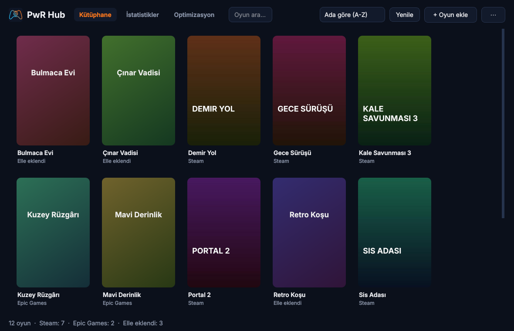
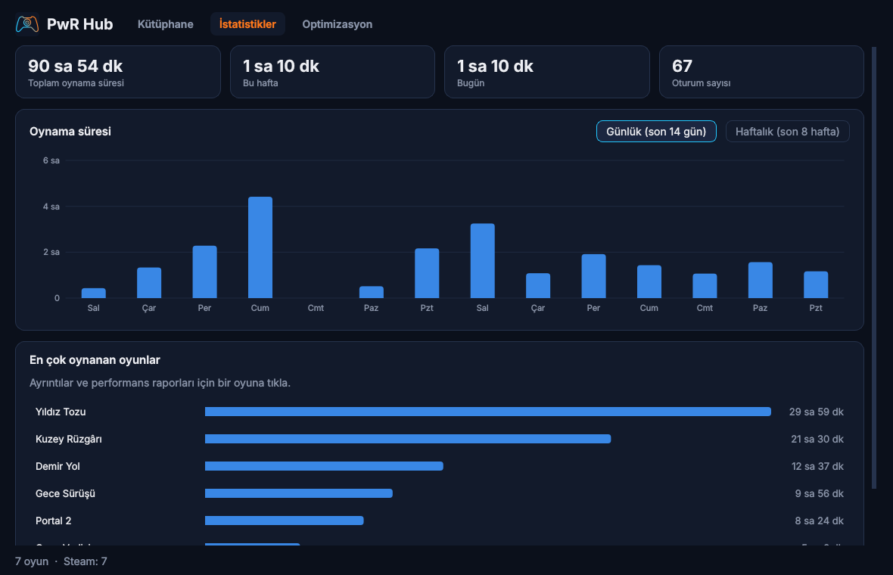
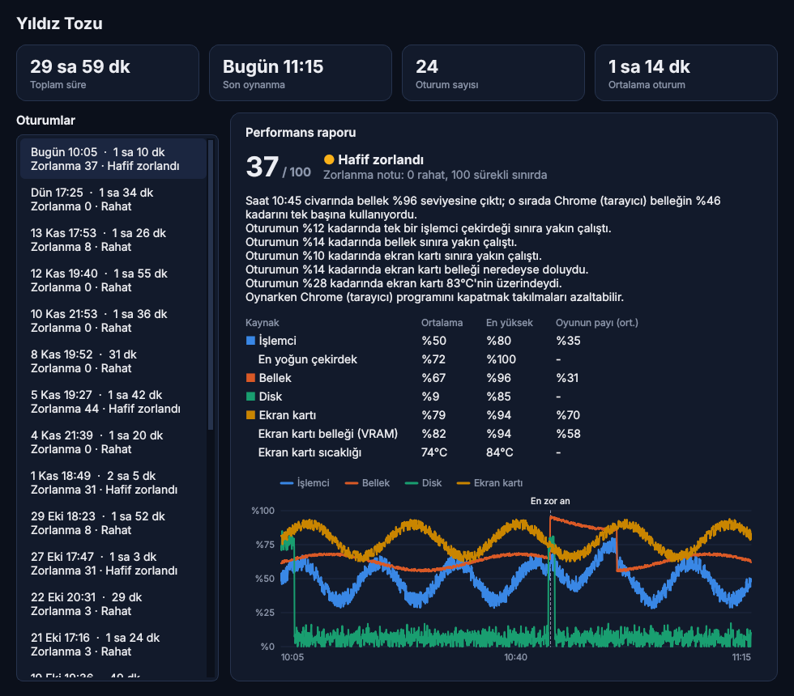
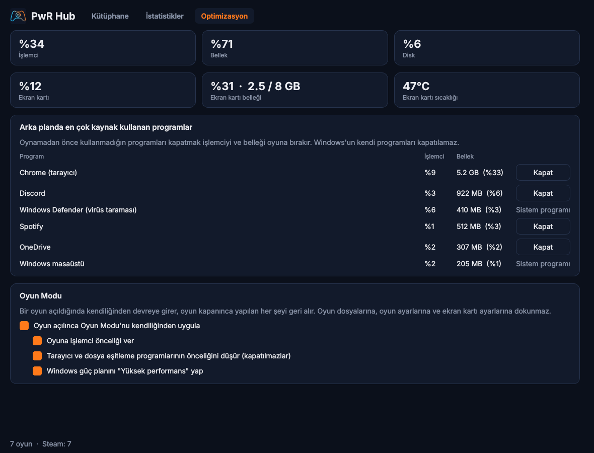

<p align="center">
  
</p>

# PwR Hub

Windows için açık kaynaklı oyun başlatıcısı ve performans izleme aracı.

PwR Hub, farklı yerlerdeki oyunlarını (Steam, Epic Games, kendi klasörlerin)
tek bir kütüphanede toplar ve tek tıkla başlatır. Ne kadar oynadığını kaydeder,
oyun sırasında bilgisayarının ne kadar zorlandığını ölçer ve oyun bitince
takılmanın olası sebebini sade bir dille anlatır.

**Verilerin sende kalır.** PwR Hub internete hiçbir şey göndermez; kapak
resimleri dahil her şey bilgisayarındaki dosyalardan okunur.

## Ekran görüntüleri

| Kütüphane | İstatistikler |
| --- | --- |
|  |  |
| **Performans raporu** | **Optimizasyon** |
|  |  |

> Görüntüler örnek (uydurma) oyun adları ve verilerle alınmıştır. Kendi
> görüntülerini `docs/screenshots/` klasörüne koyup burayı güncelleyebilirsin.

## Özellikler

### Oyun kütüphanesi

- Steam kütüphanesini kendiliğinden bulur (birden fazla diskteki kütüphaneler dahil).
- Epic Games Launcher ile kurulan oyunları bulur.
- Elle eklediğin klasörlerdeki oyunları ya da tek tek seçtiğin `.exe` dosyalarını ekler.
- Oyunları kapak resmi ve adıyla ızgara görünümünde gösterir.
- Arama (Türkçe harflere duyarlı) ve sıralama: ada göre, son açılan, son eklenen, kaynağa göre.
- Karta tıklayınca oyunu başlatır.
- Sağ tık menüsü: istatistikler, oyun klasörünü aç, kendi kapak resmini seç, oyunu gizle.

### Oynanma istatistikleri

- PwR Hub açıkken oyunların açılıp kapanmasını kendiliğinden fark eder; oyunu
  Steam'den ya da masaüstü kısayolundan açsan da oturum kaydedilir.
- Her oyun için toplam süre, son oynanma, oturum sayısı ve ortalama oturum süresi.
- İstatistikler sayfası: günlük (son 14 gün) ve haftalık (son 8 hafta) süre
  grafikleri, en çok oynanan oyunlar, toplam oynama süresi.

### Performans kaydı ve takılma dedektifi

- Oyun açıkken 3 saniyede bir işlemci, en yoğun işlemci çekirdeği, bellek ve
  disk kullanımını; deneysel olarak da ekran kartı kullanımını, ekran kartı
  belleğini (VRAM) ve ekran kartı sıcaklığını kaydeder. Oyunun kendi payını ve
  arka plandaki programların payını ayrı tutar.
- Oyun kapanınca kısa bir rapor açılır: ortalama ve en yüksek kullanım,
  bilgisayarın en çok zorlandığı an ve o anda kaynağı en çok tüketen program.
- 0-100 arası **zorlanma notu** ve sade dilde yorum. Örnek: *"Saat 21:40
  civarında bellek %95 seviyesine çıktı; o sırada Chrome (tarayıcı) belleğin
  %48 kadarını tek başına kullanıyordu."*
- Her oturum için işlemci / bellek / disk / ekran kartı grafiği (oyuna sağ tık →
  **İstatistikler ve performans**, ya da İstatistikler sayfasında oyuna tıkla).
- Tek çekirdek darboğazını yakalar: toplam işlemci kullanımı düşük görünse
  bile tek bir çekirdek sınırdaysa bunu raporlar.

### Optimizasyon

- **Anlık kullanım:** işlemci, bellek, disk, ekran kartı, ekran kartı belleği
  (VRAM) ve ekran kartı sıcaklığı.
- **Arka plan programları:** en çok kaynak kullanan programları gösterir;
  istediğini tek tıkla (onay sorarak) kapatabilirsin. Hiçbir program
  kendiliğinden kapatılmaz ve Windows'un kendi programları kapatılamaz.
- **Oyun Modu** (isteğe bağlı, varsayılan olarak kapalı): bir oyun açılınca
  kendiliğinden devreye girer, oyun kapanınca **her şeyi geri alır**:
  - oyuna işlemci önceliği verir,
  - tarayıcı ve dosya eşitleme programlarının önceliğini düşürür (kapatmaz),
  - Windows güç planını "Yüksek performans" yapar.

Oyun Modu oyun dosyalarına, oyunların grafik ayarlarına ve ekran kartı
ayarlarına dokunmaz. Sihirli bir FPS artışı vaat etmez; arka planda çok
program açıkken ya da dizüstünde güç tasarrufu planı etkinken fark yaratır.

### Arka planda çalışma

- Pencereyi kapatınca PwR Hub saatin yanındaki bildirim alanında (sistem
  tepsisi) çalışmaya devam eder; oturumlar kaydedilir, oyun bitince bildirim
  gelir. Tamamen kapatmak için simgeye sağ tıkla → **Çıkış**.
- İstersen **⋯ → Windows açılınca PwR Hub'ı başlat** ile bilgisayar açılınca
  kendiliğinden (pencere açmadan) başlar.

## Kurulum

### Kolay yol: PwRHub.exe

[Releases](https://github.com/BagwelPower/PwR-Hub/releases/latest) sayfasından
`PwRHub.exe` dosyasını indir. Tek dosyadır; kurulum gerektirmez, Python
gerektirmez. İstediğin bir klasöre koyup çift tıkla.

- **İlk açılışta Windows uyarı gösterebilir** ("Windows kişisel bilgisayarınızı
  korudu"). Dosya dijital olarak imzalı olmadığı için bu olağandır:
  **Ek bilgi → Yine de çalıştır**.
- Tek dosya olduğu için açılması birkaç saniye sürebilir.
- "Windows açılınca başlat" ayarını kullanıyorsan `.exe` dosyasını sonradan
  başka bir klasöre taşıma; taşırsan ayarı kapatıp yeniden aç.

### Kaynak koddan çalıştırma

Gerekenler: Windows 10/11 ve [Python 3.10 ya da üstü](https://www.python.org/downloads/)
(kurarken "Add Python to PATH" kutusunu işaretle).

Proje klasöründe bir komut satırı (PowerShell) aç ve sırayla çalıştır:

```bash
python -m venv .venv
```

```bash
.venv\Scripts\activate
```

```bash
pip install -r requirements.txt
```

```bash
python -m pwrhub
```

Sonraki açılışlarda yalnızca `.venv\Scripts\activate` ve `python -m pwrhub`
yeterlidir.

### PwRHub.exe dosyasını kendin üretmek

Windows'ta proje klasöründe:

```bash
build.bat
```

Çıktı `dist\PwRHub.exe` olur. GitHub'daki iş akışı
(`.github/workflows/build.yml`) her gönderimde testleri gerçek Windows üzerinde
çalıştırır ve `.exe` dosyasını üretir. `pwrhub/__init__.py` içindeki sürüm
numarası artırılıp `main` dalına gönderildiğinde dosya kendiliğinden Releases
sayfasına eklenir.

## Kullanım

| Ne yapmak istiyorsun? | Nasıl? |
| --- | --- |
| Oyunu başlatmak | Kartına tıkla |
| Oyun aramak | Üstteki arama kutusuna yaz (`Ctrl+F`) |
| Kütüphaneyi yeniden taramak | **Yenile** düğmesi (`F5`) |
| Steam/Epic dışındaki oyunları eklemek | **+ Oyun ekle → Oyun klasörü ekle…** |
| Kapak resmini değiştirmek | Karta sağ tıkla → **Kapak resmi seç…** |
| Oynama sürelerini görmek | Üstteki **İstatistikler** düğmesi |
| Bir oyunun oturumlarını ve performans raporlarını görmek | Karta sağ tıkla → **İstatistikler ve performans** |
| Bir oyunu gizlemek / geri getirmek | Sağ tık → **Kütüphaneden gizle**; geri getirmek için **⋯ → Gizlenen oyunları göster** |

**Klasör ekleme nasıl çalışır?** İçinde birçok oyun bulunan bir klasör
(ör. `D:\Oyunlar`) eklersen her alt klasör ayrı bir oyun olarak görünür. Tek bir
oyunun klasörünü eklersen yalnızca o oyun eklenir. Yanlış dosya seçilirse
oyunu **Tek bir oyun (.exe) ekle…** ile doğrudan gösterebilirsin.

**Kapak resimleri:** Steam oyunlarının kapakları Steam'in bilgisayarındaki
önbelleğinden alınır. Kapağı bulunmayan oyunlar (Epic ve elle eklenenler) için
oyunun simgesi ve adıyla renkli bir kart çizilir; istersen kendi resmini
seçebilirsin.

## Oturum takibi ve performans kaydı nasıl çalışır?

- **PwR Hub çalışıyor olmalı.** Pencereyi kapatman sorun değil (tepside
  çalışmaya devam eder), ama uygulamadan tamamen çıkarsan oturumlar kaydedilmez.
- Bir program, dosyası bir oyunun kurulum klasöründeyse o oyuna ait sayılır.
  Oyun kapandıktan 30 saniye sonra oturum biter; 20 saniyeden kısa oturumlar
  kaydedilmez.
- Oyun açık değilken PwR Hub 5 saniyede bir yalnızca "oyun başladı mı" diye
  bakar; ayrıntılı ölçüm sadece oyun sırasında yapılır.
- Arka plandaki programların payı 12 saniyede bir güncellenir; bu yüzden
  rapordaki "o sırada en çok kullanan program" birkaç saniye öncesine ait olabilir.
- **"Disk %"** diskin doluluğu değil, okuma/yazma ile ne kadar meşgul
  olduğudur (Görev Yöneticisi'ndeki değer gibi). Takılmalarla ilgili olan budur.

**Zorlanma notu:** Her ölçümde bir kaynak rahat eşiğini aştıkça zorlanma
artar. O anın zorlanması, kaynaklardan en kötüsüdür. Oturum notu, en kötü
anlar ile ortalamanın karışımıdır: 0-24 *Rahat*, 25-49 *Hafif zorlandı*,
50-74 *Zorlandı*, 75-100 *Çok zorlandı*.

| Kaynak | Zorlanma başlar | Nota en fazla katkısı |
| --- | --- | --- |
| İşlemci (toplam) | %70 | 100 |
| Bellek | %80 | 100 |
| Disk | %80 | 100 |
| En yoğun işlemci çekirdeği | %85 | 60 |
| Ekran kartı kullanımı | %90 | 50 |
| Ekran kartı belleği (VRAM) | %90 | 80 |
| Ekran kartı sıcaklığı | 83°C (95°C'de en yüksek) | 60 |

Tek çekirdek ve ekran kartı kullanımının katkısı bilerek sınırlıdır: FPS sınırı
olmayan oyunlarda bunların sınırda çalışması olağandır ve tek başına takılma
demek değildir. VRAM dolunca dokular diske taşar ve oyun takılır; ekran kartı
çok ısınınca kendini korumak için yavaşlar.

**Bilinen sınırlar**

- **Ekran kartı ölçümleri deneyseldir** ve yalnızca okuma yapar (fan, hız
  aşırtma, sürücü ayarlarına dokunulmaz):
  - *Kullanım ve VRAM:* Windows 10 (1709) ve sonrasında, Görev Yöneticisi'nin
    kullandığı sayaçlardan okunur; ekran kartının markası fark etmez.
  - *Sıcaklık:* NVIDIA kartlarda sürücüyle gelen `nvidia-smi` aracından,
    diğer kartlarda Windows'un kendi çağrısından okunur. İşlemciye gömülü
    ekran kartları ve bazı sürücüler sıcaklık bildirmez.
  - Okunamayan değer "Ölçülemiyor" olarak görünür, raporda o satır gizlenir;
    uygulamanın geri kalanı etkilenmez.
- Hile koruması olan bazı oyunlarda oyunun kendi işlemci/bellek payı
  okunamayabilir; oturum süresi yine de kaydedilir.
- Eşikler genel değerlerdir; her bilgisayar ve oyun için kusursuz değildir.

## PwR Hub'ın kendisi ne kadar kaynak harcar?

Performans ölçen bir araç kendisi yük olmamalı. Bunun için:

- **Oyun kapalıyken** 5 saniyede bir yalnızca "yeni bir program açıldı mı"
  diye bakılır; bilinen programlar için hiçbir sorgu yapılmaz.
- **Oyun açıkken** her 3 saniyede yalnızca oyunun kendi süreçleri ölçülür.
  Bütün programların ölçümü (arka planda en çok kaynak tüketeni bulmak için)
  12 saniyede bir yapılır; aradaki ölçümlerde son bilinen değerler kullanılır.
- **Diske yazma** seyrektir: ölçümler bellekte biriktirilip yaklaşık 15
  saniyede bir tek seferde yazılır. PwR Hub beklenmedik kapanırsa en fazla
  son 15 saniye kaybolur.
- İzleme düşük öncelikle çalışır; oyunun işlemci zamanını kapmaz.
- Pencere kapalıyken (tepside) kapak resimleri bellekten atılır;
  Optimizasyon sayfası yalnızca açıkken ölçüm yapar.

Geliştirme ortamında (yaklaşık 380 çalışan program, 60 oyunluk kütüphane)
ölçülen değerler: oyun kapalıyken tek bir işlemci çekirdeğinin yaklaşık
%0,01'i, oyun açıkken yaklaşık %0,13'ü; bellek yaklaşık 85-90 MB. Windows'ta
değerler biraz farklı olabilir.

## Veriler nerede?

Her şey `%APPDATA%\PwRHub` klasöründedir:

- `pwrhub.db` — kütüphane, oturumlar ve performans ölçümleri (SQLite)
- `pwrhub.log` — günlük dosyası; bir şey çalışmıyorsa (ör. ekran kartı
  "Ölçülemiyor" diyorsa) sebebi burada yazar
- `covers\` — senin seçtiğin kapak resimleri

Bu klasörü silmek uygulamayı sıfırlar; oyunlarına dokunulmaz.

## Geliştirme

```bash
pip install -r requirements-dev.txt
```

```bash
python -m pytest
```

Testler gerçek Steam/Epic kurulumuna ihtiyaç duymaz; geçici klasörlerde sahte
kurulumlar oluşturur.

### Proje yapısı

```
pwrhub/
  app.py            Giriş noktası
  config.py         Veri klasörü yolları
  models.py         Game veri modeli
  db.py             SQLite veritabanı
  vdf.py            Steam'in VDF/ACF dosya biçimi için ayrıştırıcı
  library.py        Bütün kaynakları tarayıp veritabanını günceller
  launcher.py       Oyun başlatma
  scanners/         Steam, Epic ve klasör tarayıcıları
  procscan.py       Çalışan programları ve sistem kullanımını okur (psutil)
  matching.py       Çalışan programları oyunlarla eşleştirir
  sessions.py       Oturum takibi (başlangıç, bitiş, kısa kesintiler)
  monitor.py        İzleme motoru: oturumlar + performans örnekleri
  report.py         Takılma dedektifi: zorlanma notu ve sade dilde rapor
  stats.py          Günlük/haftalık toplamlar, süre biçimlendirme
  gpu.py            Ekran kartı kullanımı, VRAM ve sıcaklık (deneysel, yalnızca Windows)
  boost.py          Oyun Modu: öncelikler ve güç planı (geri alınabilir)
  optimizer.py      Arka plan programlarını listeler, istenince kapatır
  autostart.py      Windows açılışında başlatma ayarı
  ui/               PySide6 arayüzü (ızgara, istatistik sayfası, grafikler, rapor)
  assets/           Logo dosyaları (SVG, PNG, .ico)
tools/make_logo.py  Logoyu yeniden üretir (yalnızca logo değişecekse)
pwrhub.spec         Tek dosyalık .exe tarifi (PyInstaller)
build.bat           Windows'ta .exe üretir
tests/              pytest testleri
```

### Neden Python + PySide6?

- Çekirdek zaten Python (psutil, SQLite); arayüz de Python olunca tek dil,
  tek süreç olur. Electron'da arayüz ile Python çekirdeği arasında ayrı bir
  köprü kurmak gerekirdi.
- PwR Hub oyun sırasında arka planda açık kalacak. Qt, Electron'a göre çok
  daha az bellek kullanır; performans ölçen bir aracın kendisi yük olmamalı.
- Qt'nin ızgara görünümü yüzlerce oyunda bile akıcıdır ve tek dosyalık
  `.exe` paketlemesi (PyInstaller) kolaydır.

## Yol haritası

- [x] **1. aşama — Oyun kütüphanesi:** Steam, Epic ve klasör taraması; ızgara, arama, sıralama; tek tıkla başlatma
- [x] **2. aşama — Oynanma istatistikleri:** oturum takibi; oyun başına toplam süre, son oynanma, oturum sayısı; günlük/haftalık grafikler
- [x] **3. aşama — Performans kaydı ve takılma dedektifi:** işlemci, bellek, disk kaydı; oturum sonu raporu; 0-100 zorlanma notu ve sade dilde yorum

Sonraki fikirler:

- [x] Tek çekirdek darboğazını ölçmek ve raporlamak
- [x] Sistem tepsisinde arka planda çalışma ve Windows ile birlikte açılma
- [x] Ekran kartı kullanımı (deneysel)
- [x] Optimizasyon sayfası ve Oyun Modu
- [x] Ekran kartı sıcaklığı ve belleği (VRAM) (deneysel)
- [ ] İşlemci sıcaklığı
- [ ] Oyun başına Oyun Modu ayarı
- [x] Tek dosyalık `.exe` paketi (PyInstaller)
- [ ] İngilizce arayüz

Kapsam dışı: ekran kartı ayarlarını değiştirme (overclock, fan hızı, sürücü),
oyunların grafik ayar dosyalarını değiştirme, oyun içi filtreler, ekran kaydı,
mod tarama ve güvenlik özellikleri.

## Lisans

[MIT](LICENSE)
